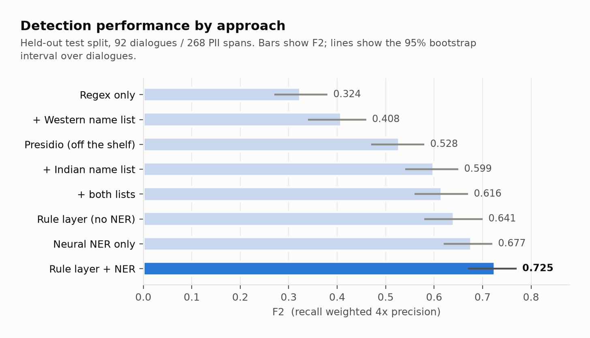
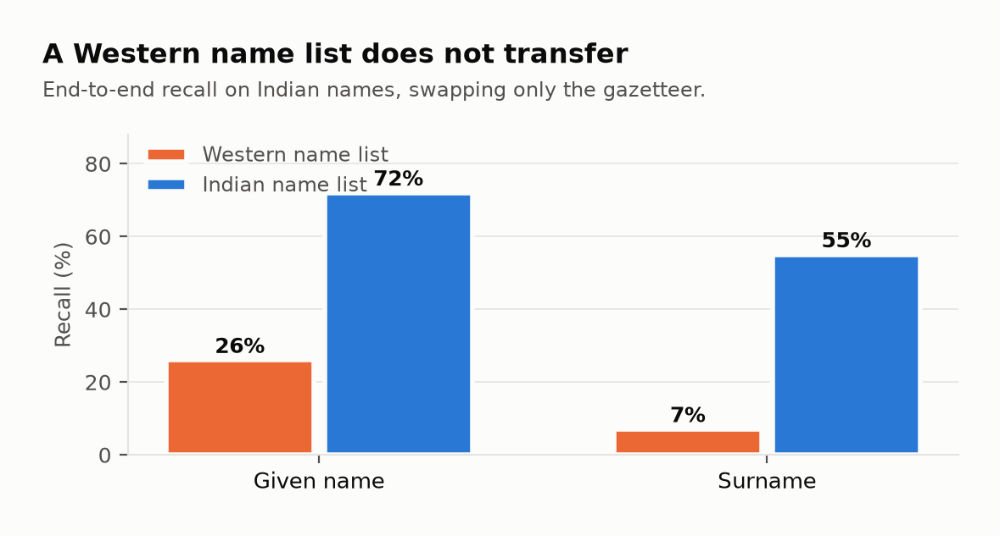
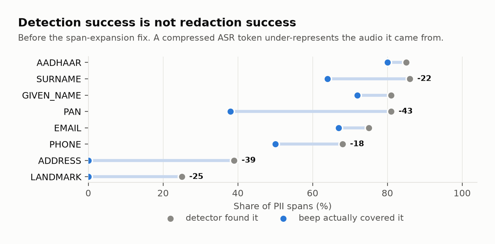
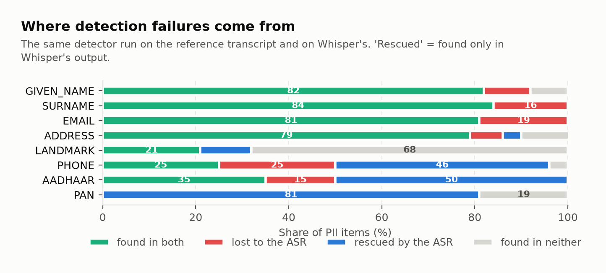
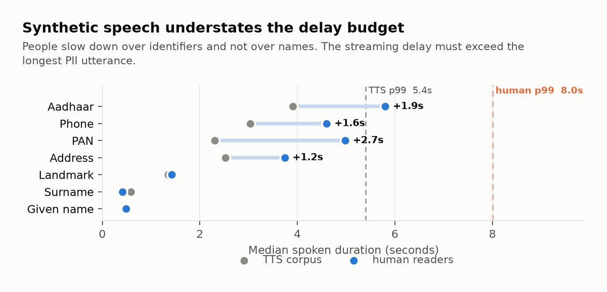
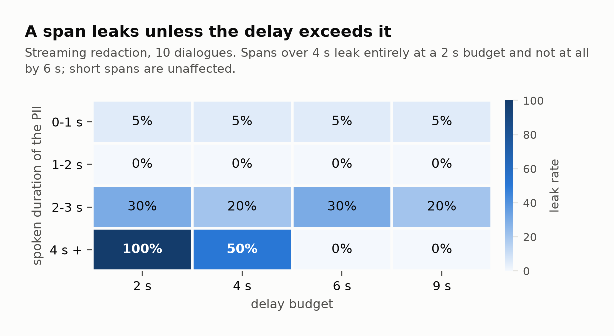

# PII Detection and Redaction in Audio Streams

**Team Interceptors (Team 14)** · Applications of Deep Learning with Knowledge
Representation & Reasoning · Demo track

> Draft. Streaming sweep and figures outstanding.

---

## Abstract

We built a locally-run pipeline that detects and redacts personally
identifiable information in spoken audio, and — more importantly — an
evaluation that says where such a pipeline actually loses accuracy. On a
152-dialogue corpus of Indian customer-support speech with exact ground-truth
timings, a four-level comparison takes F2 from 0.32 (regex only) to 0.72
(rules + neural NER). An error-attribution experiment shows that of the items
the full system fails to redact, **52% were destroyed by speech recognition
and 48% were never found by the detector** — neither half of the pipeline
dominates.

Three findings contradict assumptions we began with. Whisper never leaves
spoken digits as words; it normalises them and preserves the speaker's
prosodic grouping as punctuation, which breaks consecutive-digit patterns
(32% → 81% recall once patterns tolerate the separators). For structured
identifiers the ASR **helps** — a perfect transcript would score worse.
And landmark-relative addresses, characteristic of Indian speech, are
detected by nothing we tried: 7% recall across all four levels.

---

## 1. Problem statement and motivation

Customer support calls and online meetings record a great deal of personal
information. Under India's Digital Personal Data Protection Act and the GDPR,
that information is supposed to be removed before recordings are stored or
shared. Doing this for text is routine. Doing it for audio is not.

The difficulty is that audio cannot be searched directly. Speech must first be
converted to text, the sensitive parts located, and then mapped back to
precise time ranges so they can be overwritten. That is two models in series,
and mistakes made by the first are invisible to the second: if the recogniser
mishears a name, the detector never sees a name, nothing is redacted, and the
name plays in the clear.

We also require the whole system to run locally. Uploading private recordings
to a cloud service in order to have the private parts removed defeats the
purpose.

### 1.1 What we expected, and what we found

Our proposal argued that spoken-out numbers would be the central problem —
that "my number is nine eight seven six" would defeat a regular expression
looking for digits. We tested this directly and it is **false** for Whisper.
Of 96 numeric identifiers in our corpus, **zero** were left as words.

The real failure mode is subtler and is reported in §5.1.

---

## 2. Course concepts used

**Unit 5 — Deep learning.** Whisper is a sequence-to-sequence Transformer;
its first layers are convolutional, running over a spectrogram. Word-level
timings are not a native output — they are recovered from the decoder's
cross-attention weights by dynamic time warping, which is why they are
accurate only to a few hundred milliseconds, and why §5.4's compression
finding arises at all. The NER layer is a Transformer encoder performing
token-level classification. All models are used via transfer learning; nothing
is trained from scratch.

**Unit 2 — Search.** Whisper constructs its transcript by beam search, a
best-first search over token sequences with the frontier capped at a fixed
width. Dynamic time warping over the attention matrix is a shortest-path
problem on a grid, and is what produces word boundaries.

**Unit 3 — Knowledge representation and reasoning.** PII is represented as a
taxonomy rather than a flat label set (§4.2), because the branches require
genuinely different machinery. The decision to redact is expressed as rules
over detector output — *redact if the token is in a name list and is not a
common English word, or if it follows a name-introducing phrase* — so every
redaction carries the rule that produced it.

**Unit 4 — Rational choice under unequal payoffs.** Missing an identifier is a
privacy breach; beeping one extra word is an annoyance. We therefore report F2
rather than F1, and report the share of ordinary speech destroyed alongside it
(§4.4), because F2 alone does not capture a redaction that ruins the recording.

---

## 3. Related work

Whisper [1] is the standard open speech model; faster-whisper [4] is a
reimplementation fast enough to make local operation practical. WhisperX [2]
improves timing accuracy using forced alignment against wav2vec 2.0 [3]; we
considered and rejected this (§4.3). Named entity recognition builds on
Transformer encoders [6] and earlier BiLSTM-CRF work [5]; AI4Bharat's
Naamapadam [7] exists precisely because Western datasets such as CoNLL-2003
[8] do not transfer to Indic names — a claim we measure directly in §5.3.

Microsoft Presidio [9] is the main open-source PII tool; AWS Transcribe and
AssemblyAI sell audio PII redaction as cloud services. All are cloud-first or
text-first. None is built or evaluated for Indian conversational speech.

---

## 4. Approach

### 4.1 Pipeline

```
audio ──► faster-whisper ──► transcript + word timings
                                   │
                                   ├──► detectors ──► character spans
                                   │
                            char_to_time bridge
                                   │
                                   ▼
                       overwrite samples with a tone ──► redacted audio
```

Detectors operate purely on character offsets in a string and know nothing
about audio. A single function bridges to time. This keeps detectors testable
on plain strings and — critically — makes the error-attribution experiment
(§5.5) a matter of passing in a different string.

Redaction **overwrites** samples with a tone rather than attenuating them or
mixing a tone on top; both of those leave the original signal recoverable.
Measured correlation between original and redacted audio inside a redacted
region is **−0.009**.

### 4.2 PII taxonomy

| branch | leaves | why it needs its own machinery |
|---|---|---|
| IDENTIFIER | AADHAAR, PAN, PHONE, EMAIL | rigid surface form; patterns viable |
| PERSON | GIVEN_NAME, SURNAME | open class; no pattern exists |
| LOCATION | ADDRESS, LANDMARK | landmark-relative in Indian speech |

### 4.3 Corpus and ground truth

No public dataset of Indian conversational audio with labelled PII exists, so
we generated one: 38 templates → **152 dialogues → 440 PII spans**, 42.3
minutes, rendered with three Indian-English voices.

**Ground-truth timings are exact by construction.** Each dialogue is authored
as alternating ordinary/PII segments and rendered one segment at a time,
accumulating a sample offset; the offset at which a PII segment lands *is* its
true start time. We rejected forced alignment because the proposal also
intended it as a pipeline stage, which would have made the same component both
the thing under test and the definition of truth.

Every numeric identifier is generated with a known canonical value and spoken
in one of four realistic styles — `digit_by_digit`, `with_doubles`, `paired`,
`grouped` — balanced at 24 each, so speaking style is an experimental variable
rather than an incidental detail.

**Splits are by template, never by dialogue** (15 templates / 60 dialogues
dev; 23 / 92 test; zero overlap). Dialogues from one template share phrasing,
so a dialogue-level split would place near-identical sentences in both halves.
We train nothing, but we *tune* — thresholds, margins, filters — on dev, and
tuning is fitting.

**Validation:** 440/440 spans slice their transcript correctly and land on
real speech. Two rendering bugs were caught this way: macOS `say` *speaks*
punctuation (0.96 s for a full stop, 288 occurrences) and exits with status 0
while writing silence (5 spans), the latter producing gold spans no detector
could ever find.

### 4.4 Metrics

**Recall is span-level** — each item is either protected or not. **Precision is
duration-level** — what share of destroyed audio needed destroying. The mixed
units are deliberate: span-counted precision scores a detector that beeps the
*entire recording* at P=1.00, R=1.00, F2=1.00, because one giant span overlaps
every gold span and records no false positives. Under duration-based precision
that detector scores F2 0.62 with over-redaction at 100%.

We report F2, precision, over-redaction, and **coverage** — the fraction of
each sensitive region actually destroyed, separate from whether it was
detected at all (§5.4).

Confidence intervals are bootstrapped **over dialogues, not spans**: spans
within a dialogue share a speaker, template and transcription, so resampling
spans would understate intervals badly. Comparisons between levels use a
**paired** bootstrap on the same dialogues, because checking whether two
independently-computed intervals overlap is strictly more conservative than
testing whether the difference is zero.

### 4.5 Comparison levels

| level | contents |
|---|---|
| 1 | regex only |
| 2 | regex + name gazetteer (western / indian / both) |
| 3 | Microsoft Presidio, off the shelf |
| 4 | regex + gazetteer + context rules + neural NER |

Presidio is configured as charitably as is reasonable, on the same principle
that governs our own baseline. It keeps every entity type that could land on
real PII **including ones that match for the wrong reason** — a 12-digit
Aadhaar returns as `US_BANK_NUMBER`, and we count that as a hit, because our
scoring is type-agnostic for redaction: the person is protected whatever label
caused it. Four types with no counterpart in our gold (`DATE_TIME`, `URL`,
`NRP`, `AGE`) are dropped, which helps Presidio's precision rather than ours.
It runs on `en_core_web_md`, the same spaCy model our own NER uses, so the
comparison is not confounded by model size.

Gazetteers come from outside our generation vocabulary — NLTK US-Census names
(7.5k) and Indian-Male/Female name lists (8.7k). Building them from our own
vocabulary would give Level 2 perfect prior knowledge of every corpus name: an
oracle rather than a baseline.

Patterns are written against what the ASR actually emits rather than clean
typed text, because §4.3 of the proposal notes that a weak baseline would be
unfair *in our favour*. Measured, that choice is worth 49 points of recall on
numeric identifiers.

---

## 5. Results

All figures on the held-out test split: 92 dialogues, 268 PII spans.

### 5.1 The normalisation finding

Of 96 numeric identifiers, **none** survived as words. Whisper normalises them
to numerals — but preserves the speaker's prosodic grouping as punctuation:

```
spoken  "nine six zero, five nine five, seven four five, four"
ASR     960 -595 -745 -4
spoken  "ninety seven, forty seven, seventy six, sixty nine, fourteen"
ASR     97, 47, 76, 69, 14
```

Every digit is present and correct. A pattern requiring ten *consecutive*
digits sees none of them.

| pattern | recall on numeric PII | false positives |
|---|---|---|
| consecutive digits | 32.3% | 0 |
| separator-tolerant | **81.2%** | 0 |

Emails receive a half-normalisation matching neither the typed nor the spoken
form: `neha dot goli at gmail dot com` → `neha .goli at gmail .com`.

### 5.2 Level comparison



| level | recall | precision | **F2** | over-redaction |
|---|---|---|---|---|
| L1 regex only | 0.276 | 0.866 | 0.320 [0.26–0.37] | 3.4% |
| L2 + western list | 0.358 | 0.824 | 0.404 [0.34–0.46] | 5.1% |
| L2 + indian list | 0.560 | 0.797 | 0.595 [0.54–0.65] | 7.0% |
| L2 + both lists | 0.582 | 0.779 | 0.613 [0.56–0.67] | 8.0% |
| **L3 Presidio** | 0.470 | 0.666 | **0.500 [0.44–0.55]** | 8.4% |
| L4 rules (no NER) | 0.608 | 0.789 | 0.637 [0.58–0.70] | 7.5% |
| NER only *(ablation)* | 0.653 | 0.750 | 0.670 [0.62–0.72] | 10.2% |
| **L4 rules + NER** | **0.713** | 0.746 | **0.719 [0.67–0.76]** | 10.9% |

Paired comparisons on the same dialogues:

| comparison | ΔF2 | 95% CI | significant |
|---|---|---|---|
| indian list vs western list | +0.191 | [+0.144, +0.241] | yes |
| NER only vs rules only | +0.035 | [−0.003, +0.072] | **no** |
| rules + NER vs NER only | +0.049 | [+0.026, +0.077] | yes |
| rules + NER vs rules only | +0.083 | [+0.057, +0.111] | yes |

| rules + NER vs Presidio | +0.220 | [+0.166, +0.271] | yes |
| Presidio vs regex only | +0.180 | [+0.102, +0.256] | yes |

**Neither the rule layer nor the neural model is clearly better alone, but each
adds significantly on top of the other.** On given names the rules reach 78%,
the NER 69%, and together 85% — they recover different names.

#### Presidio, and why it loses

Presidio sits between our Level 1 and Level 2 — a legitimate mid-tier
baseline, not a strawman. The per-type breakdown shows the loss is not
distributed evenly:

| type | Presidio | ours | gap |
|---|---|---|---|
| SURNAME | 84% | 89% | −5 |
| GIVEN_NAME | 69% | 84% | −15 |
| PHONE | 61% | 68% | −7 |
| ADDRESS | 39% | 61% | −22 |
| **EMAIL** | **14%** | 75% | **−61** |
| **AADHAAR** | **30%** | 85% | **−55** |
| **PAN** | **12%** | 81% | **−69** |

It is **competitive on names** — both systems use the same spaCy model — and
**collapses on structured identifiers**, which is precisely the mismatch §5.1
describes. Presidio's recognisers expect typed text; ASR output fragments
digit runs (`960 -595 -745 -4`) and half-normalises emails
(`neha .goli at gmail .com`). On our own regex level that same distinction was
worth 49 points of recall.

Two further observations. This Presidio build exposes **no India-specific
recognizers** — there is no `IN_PAN` or `IN_AADHAAR` among its 24 supported
entities, so Aadhaar is caught only incidentally as `US_BANK_NUMBER` (12
digits) and PAN is missed almost entirely, with the *word* "PAN" returned as
an organisation. And its precision is lower than ours (0.666 vs 0.746) despite
lower recall, because its generic recognizers fire on multiple labels for the
same span.

This is §3's motivation turned into a measurement, exactly as §5.3 did for §1:
the leading open-source PII tool is built for typed text, and loses most of
its structured-identifier recall when handed speech.

### 5.3 Western name lists do not transfer



| name group | western list | indian list |
|---|---|---|
| common Indian given names | **11%** | 80% |
| given names that are English words | 58% | 75% |
| surnames | **10%** | 57% |

End-to-end, swapping the list alone moves GIVEN_NAME recall from 26% to 72%
and SURNAME from 7% to 55%. The claim in §1 is measured rather than cited.

### 5.4 Detection success is not redaction success

| type | detector found | beep covered ≥90% |
|---|---|---|
| PAN | 81% | **38%** |
| PHONE | 68% | 50% |
| overall | 70% | 51% |



Cause: a collapsed token under-represents its own audio.

```
spoken  "M W P H M eight one three three G"   2.13 s
ASR     "MWPHM8133G"                          0.52 s
```

The DTW alignment gives a compressed token one narrow attention peak, so its
timestamp covers a quarter of the audio it represents. Expanding each
detection to the neighbouring undetected words took **PAN 38% → 81%** and
**PHONE 54% → 68%**, at 7.5% over-redaction instead of 3.7%.

### 5.5 Where the errors come from



The identical detector run on the reference transcript and on Whisper's. Every
item falls in exactly one cell:

| | found on ASR | not found on ASR |
|---|---|---|
| **found on reference** | both 62% | **lost to ASR 13%** |
| **not found on reference** | **rescued by ASR 13%** | neither 12% |

Of the 67 items the system fails to redact: **52% destroyed by speech
recognition, 48% never found by the detector.** Neither half dominates, so
effort directed at only one addresses at most half the remaining error.

The fourth cell is the surprise. For structured identifiers the ASR **rescues**
items — PAN 62%, AADHAAR 50%, PHONE 46% — because spoken forms are harder to
pattern-match than normalised ones. *A perfect transcript would score worse.*
(Caveat: our patterns are ASR-aware by design, so the magnitude partly
reflects pattern coverage. Open-class types carry no such confound; the 9–22%
ASR cost on names, emails and addresses is clean.)

### 5.6 Degraded audio

| condition | F2 | ΔF2 vs clean | significant |
|---|---|---|---|
| clean | 0.719 | — | — |
| pink noise, 20 dB SNR | 0.728 | +0.008 [−0.014, +0.034] | no |
| pink noise, 10 dB SNR | 0.704 | −0.015 [−0.044, +0.017] | no |
| room echo | 0.721 | +0.001 [−0.023, +0.029] | no |
| telephone band | 0.688 | −0.031 [−0.069, +0.004] | borderline |
| **telephone + noise** | **0.666** | **−0.053 [−0.095, −0.013]** | **yes** |

Additive noise and reverberation produce **no measurable degradation** at
these levels. This is worth stating plainly rather than burying: Whisper was
trained on 680,000 hours of noisy web audio and is robust to exactly this kind
of corruption. Our first attempt therefore tested the wrong thing.

The degradation that matters for this domain is the **telephone line itself** —
restriction to 300–3400 Hz and 8-bit μ-law companding, which removes frequency
bands outright rather than burying them under noise. Band-limiting alone is
borderline; band-limiting *with* background noise is the only condition in
this study that significantly degrades the system, and it is also the one that
most resembles a real support call.

Per-type under telephone + noise, against clean:

| type | clean | telephone + noise | change |
|---|---|---|---|
| EMAIL | 75% | **56%** | −19 |
| AADHAAR | 85% | 75% | −10 |
| PAN | 81% | 69% | −12 |
| GIVEN_NAME | 84% | 79% | −5 |
| SURNAME | 89% | 86% | −3 |
| PHONE | 68% | 64% | −4 |

Email degrades worst by a wide margin. This follows from §5.1: an email
survives as a *multi-token structure* (`neha .goli at gmail .com`) and the
pattern needs nearly all of it intact, so corruption anywhere breaks the
match. Names need only one token to survive.

### 5.7 What nothing detects

LANDMARK recall: regex 0%, western list 4%, indian list 7%, rules 7%, NER 4%,
**rules + NER 7%**. Phrases such as *"opposite the Forum Mall petrol pump"* and
*"behind the Ganesh temple"* defeat patterns, gazetteers and an OntoNotes NER
alike — 28 of 268 test spans effectively invisible.

This is §1's claim about landmark-relative Indian addresses, confirmed from
the failure side. ADDRESS proper reaches 61% once the NER is present;
LANDMARK does not move at all.

### 5.8 Human-recorded speech

Four readers recorded 40 of the corpus dialogues — 16.5 minutes of real
speech. Because each reads a script already in the TTS corpus, this is a
paired comparison: identical text, identical PII, identical detector, with
only the voice source varying.

**Detection accuracy is statistically indistinguishable.**

| | TTS | human | Δ |
|---|---|---|---|
| overall detection rate | 81% | 78% | **−3.1%** |

95% CI on the paired difference: **[−10.7%, +3.9%]** — not significant at
n = 40 recordings / 129 spans. Human speech is worse in 77% of bootstrap
resamples, so a small penalty is plausible, but we cannot establish one. What
we *can* say is that the interval bounds it: the cost of synthetic speech is
**at most about 11 points**, not the collapse the limitation implied.

Per reader the spread is wide (P2 −13%, P3 +9%), which is why the interval is
wide; speaker variation exceeds the TTS/human difference.

**But the corpus did flatter us — somewhere else entirely.**

Human readers take far longer over structured identifiers:

| type | TTS median | human median | TTS max | human max |
|---|---|---|---|---|
| AADHAAR | 3.91s | **5.80s** | 4.51s | 8.06s |
| PAN | 2.31s | **4.98s** | 2.65s | **11.76s** |
| PHONE | 3.03s | **4.60s** | 4.79s | 7.90s |
| GIVEN_NAME | 0.49s | 0.49s | 0.71s | 1.16s |
| SURNAME | 0.59s | 0.41s | 1.08s | 0.76s |

Names take the same time. Identifiers take 50–115% longer, because people
slow down, group digits and pause when reading out an account number — which
is precisely what a real caller does and precisely what a speech synthesiser
does not.



The consequence lands on §5.9's streaming budget:

```
delay to cover 99% of spans :  TTS 4.7 s   human  8.0 s
delay to cover every span   :  TTS 7.4 s   human 11.8 s
```

**The synthetic corpus underestimates the required delay budget by roughly
70%.** Had we reported a streaming latency requirement from TTS alone we would
have specified 5 seconds for a system that needs 8. This is the single
concrete instance we found of synthetic audio producing an optimistic result,
and it is not the one the limitation predicted.

*Method note:* scored in character space with gold spans projected by token
alignment, so no verified timings are required. An earlier version of this
analysis also reported a "span survived in the transcript" rate; it read 100%
for both conditions because positional mapping of a `replace` block returns a
location even when the word is entirely wrong. It measured alignment
behaviour rather than ASR survival and has been removed.

---

### 5.9 Streaming redaction

Playback runs a fixed delay behind capture, and a sample must be beeped before
it leaves the buffer. The delay is the entire budget available to recognise
speech, find PII and overwrite it.



| delay | window | leak rate | audio beeped | ×realtime |
|---|---|---|---|---|
| 2 s | 5 s | 16.7% | 26.7% | 1.20 |
| 4 s | 7 s | 11.1% | 34.6% | 1.19 |
| 6 s | 9 s | 11.1% | 35.9% | 1.45 |
| 9 s | 12 s | **8.3%** | 36.0% | 1.40 |

The aggregate curve flattens quickly, but it hides the mechanism. Broken down
by how long the PII took to say:

| spoken duration | delay 2 s | delay 4 s | delay 6 s | delay 9 s |
|---|---|---|---|---|
| 0–1 s | 5% | 5% | 5% | 5% |
| 1–2 s | 0% | 0% | 0% | 0% |
| 2–3 s | 30% | 20% | 30% | 20% |
| **4 s +** | **100%** | **50%** | **0%** | **0%** |

This is the structural claim confirmed. To redact a span the recogniser must
see **all** of it, which cannot happen until capture passes the span's end —
at which moment playback already sits `delay` behind. A span therefore
survives only if its spoken duration is under the budget. Spans over four
seconds leak *entirely* at a two-second delay and *not at all* by six;
sub-two-second spans are unaffected throughout.

**A faster machine does not move this.** The floor is set by how long a person
takes to say a twelve-digit number aloud — §5.8 measures that at 8.0 s for 99%
of human-spoken identifiers. Television profanity delay is 5–10 seconds for
precisely this reason.

Throughput is a separate and solvable problem: 1.19–1.45× realtime on an 8 GB
M2, so this configuration cannot currently keep pace with a live stream at
all. A smaller model, fewer passes, or a GPU would fix that; neither would
touch the latency floor.

Note also the cost side: longer delays raise the share of audio destroyed
(26.7% → 36.0%), because more passes over the same audio produce more
detections, correct and spurious alike.

### 5.10 Edge cases

Demo-track grading is on how the tool behaves on messy input, so these were
tested rather than asserted. All seven ran without crashing.

| case | words | detections | audio beeped | wall |
|---|---|---|---|---|
| pure silence, 10 s | 1 | **0** | 0.0% | 4.3 s |
| room tone, no speech | 0 | **0** | 0.0% | 1.3 s |
| dialogue containing no PII | 74 | **0** | **0.0%** | 4.2 s |
| crosstalk, two speakers | 55 | 2 | 6.8% | 16.2 s |
| long file, 12.6 min | 1822 | 120 | 27.2% | 160 s |
| 0.1 s of audio | 0 | 0 | 0.0% | 1.5 s |
| loud white noise, 5 s | 0 | 0 | 0.0% | 1.5 s |

**Silence does not produce spurious redaction.** Whisper does hallucinate on
pure silence — it emitted the single word `'You'` — but no detector fired.
This is worth recording because the closest prior system we are aware of
documents exactly this failure: its numeral rule redacts any digit run of
length ≥ 3, so hallucinated digits produce beeps on audio containing no PII
at all. Our patterns require ten digits for a phone number, twelve for
Aadhaar and a strict PAN shape, so a short hallucination cannot match. The
same tightness that costs us recall buys immunity here.

**No false positives on a clean negative**: the no-PII dialogue produced 74
words and zero detections.

**Throughput**: 0.21× realtime on the long file — faster than short files
because model loading amortises. Peak memory 1.5 GB.

## 6. Limitations

**The corpus is synthetic, and the synthesis flatters us.** Segments are
rendered individually, so there is a slight unnatural pause at every PII
boundary — a cue real speech does not provide. §5.8 measures the size of this
effect on human recordings of the same scripts.

**Agent names are not marked as PII**, so detecting them counts against us. Of
42 false positives on test, 8 are agent names. Under DPDP and GDPR an
employee's name in a recording *is* personal data, so precision is understated
by roughly a fifth of its error.

**Structured-identifier attribution is partly confounded** by our ASR-aware
patterns (§5.5).

**Single-speaker synthesis**: no crosstalk, no interruption, no turn-taking
overlap.

---

## 7. Conclusions and future work

A redaction pipeline is not one problem but two in series, and this evaluation
separates them. Both halves contribute roughly equally to the remaining error,
so neither a better recogniser nor a better detector alone would close it.

Concrete next steps, ordered by what the attribution analysis implies:

1. **Phonetic/fuzzy name matching.** Of names lost to the ASR, 6 of 14 are
   near-misses (`Rithwik` → `Ritwik`, `Bose` → `Boss`) that edit-distance or
   phonetic matching would recover.
2. **Landmark phrase handling** — currently 7% and the clearest open gap.
3. **Spoken-form patterns** for structured identifiers, which would remove the
   confound in §5.5.
4. **Streaming redaction** with a delay buffer, so a live call can be redacted
   before playback.

---

## References

1. Radford, A. et al. *Robust Speech Recognition via Large-Scale Weak Supervision.* ICML 2023.
2. Bain, M. et al. *WhisperX: Time-Accurate Speech Transcription of Long-Form Audio.* INTERSPEECH 2023.
3. Baevski, A. et al. *wav2vec 2.0.* NeurIPS 2020.
4. faster-whisper. https://github.com/SYSTRAN/faster-whisper
5. Lample, G. et al. *Neural Architectures for Named Entity Recognition.* NAACL 2016.
6. Devlin, J. et al. *BERT.* NAACL 2019.
7. Mhaske, A. et al. *Naamapadam.* ACL 2023.
8. Tjong Kim Sang, E.F. and De Meulder, F. *CoNLL-2003 Shared Task.* CoNLL 2003.
9. Microsoft Presidio. https://github.com/microsoft/presidio
10. Ai4Privacy PII-masking datasets. https://huggingface.co/ai4privacy
11. Lafferty, J. et al. *Conditional Random Fields.* ICML 2001.
